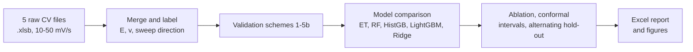
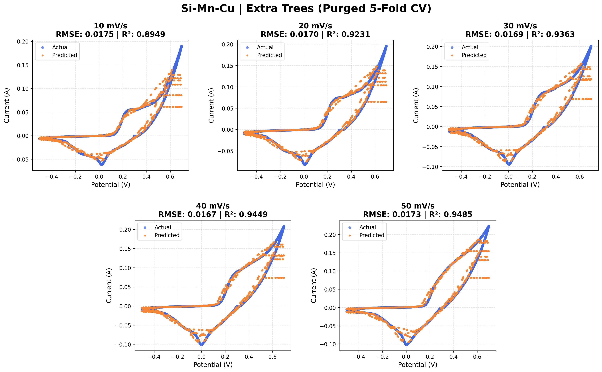
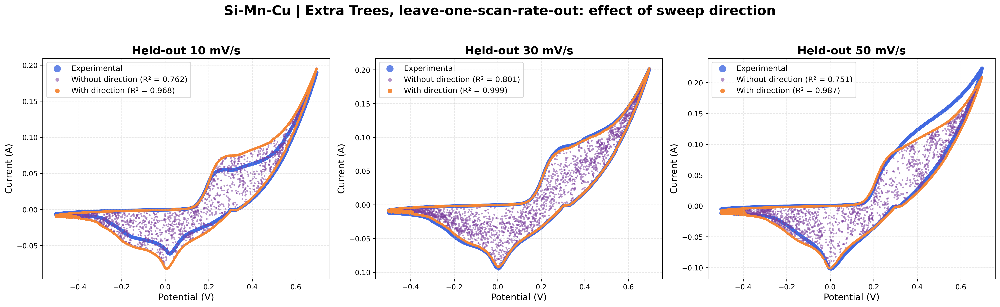
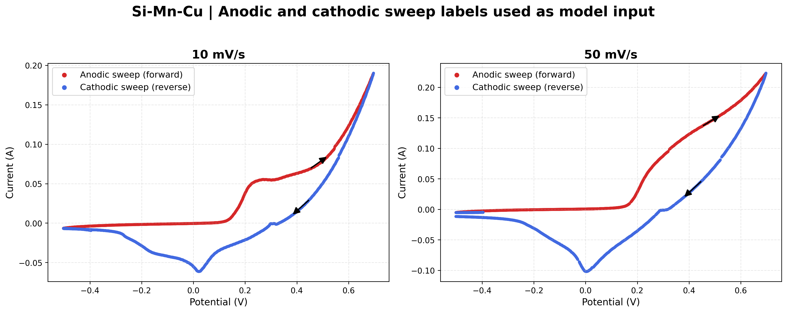

<h1 align="center">Si-Mn-Cu-CV-ML</h1>
<p align="center"><b>Machine-learning analysis of the cyclic voltammograms of a Si–Mn–Cu electrode</b><br>
Leakage-controlled validation · feature ablation · conformal intervals</p>

<p align="center">
  
  
  
  <a href="https://doi.org/10.5281/zenodo.XXXXXXX"></a>
  <a href="https://colab.research.google.com/github/YOUR_USER/Si-Mn-Cu-CV-ML/blob/main/Si-Mn-Cu_CV_ML_Colab.ipynb"></a>
</p>

<p align="center">
  <a href="#1-overview">Overview</a> ·
  <a href="#2-workflow">Workflow</a> ·
  <a href="#3-results">Results</a> ·
  <a href="#4-quick-start">Quick start</a> ·
  <a href="#5-run-time-options">Options</a> ·
  <a href="#6-repository-structure">Structure</a> ·
  <a href="#7-reproducibility">Reproducibility</a> ·
  <a href="#8-troubleshooting">Troubleshooting</a> ·
  <a href="#9-limitations">Limitations</a> ·
  <a href="#10-citation">Citation</a>
</p>

---

## 1. Overview

This repository predicts the **current** of a Si–Mn–Cu electrode from three inputs:

| Input | Meaning |
|---|---|
| `E` | Potential (V) |
| `v` | Scan rate (mV s⁻¹): 10, 20, 30, 40, 50 |
| `direction` | Sweep direction: 1 = anodic (potential increasing), 0 = cathodic (potential decreasing) |

The dataset has **12,075 points** from five CV curves (one per scan rate, −0.50 to +0.70 V). Four tree models (Extra Trees, Random Forest, HistGB, LightGBM) and a Ridge baseline are compared under **six validation schemes**, because random splits on a smooth CV curve mostly measure interpolation (R² ≈ 1.000) and say little about predictive ability.

The protocol is the same as in the TiO₂–MnO₂–GQDs study, so the two electrodes can be compared directly.

## 2. Workflow



**Validation schemes**

| # | Scheme | What is held out |
|---|---|---|
| 1 | Random 80:20 hold-out, per curve | Random points |
| 2 | Shuffled 5-fold, per curve | Random points |
| 3 | Block 5-fold, per curve (pooled R²) | Contiguous fifth of a curve (extrapolation) |
| 4 | Leave-one-scan-rate-out (LOSRO) | A complete curve |
| 5a | Combined model, shuffled 5-fold | Random points |
| 5b | Combined model, **purged** 5-fold | 40 of 200 potential bands per fold, 3 bands purged each side (19–25 % of points left for training) |

## 3. Results

Extra Trees R² (mean ± SD over curves or folds). Full tables are in `Results/*.xlsx`.

| Scheme | Extra Trees | HistGB |
|---|---|---|
| 1 Hold-out 80:20 | 1.000 ± 0.000 | 1.000 ± 0.000 |
| 2 Shuffled 5-fold | 1.000 ± 0.000 | 1.000 ± 0.000 |
| 3 Block 5-fold (pooled) | 0.794 | 0.500 |
| 4 Leave-one-scan-rate-out | 0.990 ± 0.014 | 0.983 ± 0.011 |
| 5a Combined, shuffled | 1.000 ± < 0.001 | 1.000 ± < 0.001 |
| **5b Combined, purged** | **0.943 ± 0.063** | 0.908 ± 0.054 |

<details>
<summary><b>Model comparison, purged 5-fold (5b)</b></summary>

| Model | R² |
|---|---|
| Extra Trees | 0.943 ± 0.063 |
| Random Forest | 0.912 ± 0.055 |
| HistGB | 0.908 ± 0.054 |
| LightGBM | 0.906 ± 0.058 |
| Ridge (baseline) | 0.369 ± 0.226 |

The four tree models differ by less than the fold-to-fold spread, so their ranking should not be over-interpreted.
</details>

<details>
<summary><b>Per-curve results (Extra Trees)</b></summary>

| Scan rate (mV s⁻¹) | Purged R² | Purged RMSE (A) | LOSRO R² | LOSRO RMSE (A) |
|---|---|---|---|---|
| 10 | 0.895 | 0.0175 | 0.968 | 0.010 |
| 20 | 0.923 | 0.0170 | 0.999 | 0.002 |
| 30 | 0.936 | 0.0169 | 0.999 | 0.002 |
| 40 | 0.945 | 0.0167 | 0.998 | 0.003 |
| 50 | 0.949 | 0.0173 | 0.987 | 0.009 |

Interior scan rates (20–40 mV s⁻¹) are bracketed by measured neighbours; the edge curves (10 and 50 mV s⁻¹) are extrapolations and score lower.
</details>

<details>
<summary><b>Feature ablation, sweep direction and uncertainty</b></summary>

| Inputs (Extra Trees, purged 5-fold) | R² |
|---|---|
| Potential only | 0.669 |
| Potential + scan rate | 0.690 |
| Potential + sweep direction | 0.892 |
| All three | 0.943 |

Leave-one-scan-rate-out without the direction input: R² = 0.762 / 0.801 / 0.751 for held-out 10 / 30 / 50 mV s⁻¹ (with direction: 0.968 / 0.999 / 0.987).

Alternating hold-out (train 10, 30, 50; test 20, 40 mV s⁻¹): R² = 0.999 for both.

Split-conformal 90 % intervals covered only **36 %** of held-out points (half-width 0.001 A), so they under-estimate the uncertainty.
</details>

<p align="center">
  
</p>
<p align="center">
  
</p>
<p align="center">
  
</p>

## 4. Quick start

**Google Colab (no installation).** Open `Si-Mn-Cu_CV_ML_Colab.ipynb`, run the cells in order, and upload the five `.xlsb` files when asked. The last cell downloads a zip with the Excel report and figures.

**Local, Windows**
```bash
git clone https://github.com/YOUR_USER/Si-Mn-Cu-CV-ML.git
cd Si-Mn-Cu-CV-ML
python -m venv .venv
.venv\Scripts\activate
pip install -r requirements.txt
python Src\main_paper_protocol.py
```

**Local, macOS / Linux**
```bash
git clone https://github.com/YOUR_USER/Si-Mn-Cu-CV-ML.git
cd Si-Mn-Cu-CV-ML
python3 -m venv .venv
source .venv/bin/activate
pip install -r requirements.txt
python Src/main_paper_protocol.py
```

Figures only (after the data are in `data/`):
```bash
python Src/make_figures.py            # Fig. 12 and Fig. S1
python Src/make_direction_figure.py   # Fig. 15
```

## 5. Run-time options

Set as environment variables.

| Variable | Default | Effect |
|---|---|---|
| `DATA_DIR` | `data/` (Colab: `/content/data`) | Folder with the `.xlsb` files |
| `N_TREES` | `200` | Trees for Random Forest and Extra Trees |
| `NESTED_TUNING` | `0` | `1` adds nested tuning of HistGB (slow) |
| `TUNE_ITER` | `15` | Tuning iterations when nested tuning is on |
| `OUT` | `Results/` (figure scripts) | Output folder |

Fixed in the code: seed `42`, 200 potential bands, 40 test bands per fold, purge of 3 bands, conformal level 90 %.

## 6. Repository structure

```text
Si-Mn-Cu-CV-ML/
├── data/                              # five raw CV files (.xlsb)
├── Src/
│   ├── main_paper_protocol.py         # full analysis
│   ├── make_figures.py                # Fig. 12 and Fig. S1
│   └── make_direction_figure.py       # Fig. 15
├── Results/                           # Excel report and figures
├── Si-Mn-Cu_CV_ML_Colab.ipynb         # Colab version with file upload
├── requirements.txt
├── LICENSE
├── CITATION.cff
└── README.md
```

<details>
<summary><b>Data format</b></summary>

Each `.xlsb` file holds one CV: the sheet used is the second sheet, with three columns (point index, potential in V, current in A). The scan rate is read from the **start of the file name** (`10_…`, `20_…`), so keep that naming. Sweep direction is derived by smoothing the potential (21 points) and merging direction runs shorter than 60 points.
</details>

## 7. Reproducibility

- Seed 42 for all splits and models. Results may differ slightly across library versions or with a different `N_TREES`.
- The purged folds are fixed by the seed: 200 equal-count potential bands, random assignment of 40 bands per fold.
- Hyper-parameters are library defaults. There is no tuning unless `NESTED_TUNING=1`.

## 8. Troubleshooting

| Problem | Fix |
|---|---|
| `No .xlsb files found` | Put the files in `data/` or set `DATA_DIR` |
| `ModuleNotFoundError: pyxlsb` | `pip install pyxlsb` (needed to read `.xlsb`) |
| `NameError: __file__ is not defined` | You pasted the `.py` into a notebook cell; use the Colab notebook instead |
| Wrong scan rates | File names must start with the scan rate |
| Slow run | Lower `N_TREES` (for example 100) and keep `NESTED_TUNING=0` |
| Images do not show on GitHub | File names are case-sensitive; check they match those in `Results/` |

## 9. Limitations

- One electrode and **one curve per scan rate**: the models reproduce the measured CVs, but transfer to independent experiments or other materials is not demonstrated.
- Random-split scores (R² ≈ 1.000) are interpolation only and should not be reported as predictive performance.
- The best model was chosen on the same folds that are reported (no nested tuning), so the scores are somewhat optimistic.
- The conformal intervals are not calibrated (36 % coverage against 90 % nominal).
- The sweep direction is inferred from the data order, not recorded by the instrument.

## 10. Citation

If you use this code, please cite the repository (DOI after the first Zenodo release):

```bibtex
@software{si_mn_cu_cv_ml,
  author  = {[Authors]},
  title   = {Si-Mn-Cu-CV-ML: Machine-learning analysis of the cyclic voltammograms of a Si--Mn--Cu electrode},
  year    = {2026},
  version = {v1.0.0},
  doi     = {10.5281/zenodo.XXXXXXX},
  url     = {https://github.com/YOUR_USER/Si-Mn-Cu-CV-ML}
}
```

**Contact:** [Name], [Institution], [email]

**License:** MIT, see `LICENSE`.
